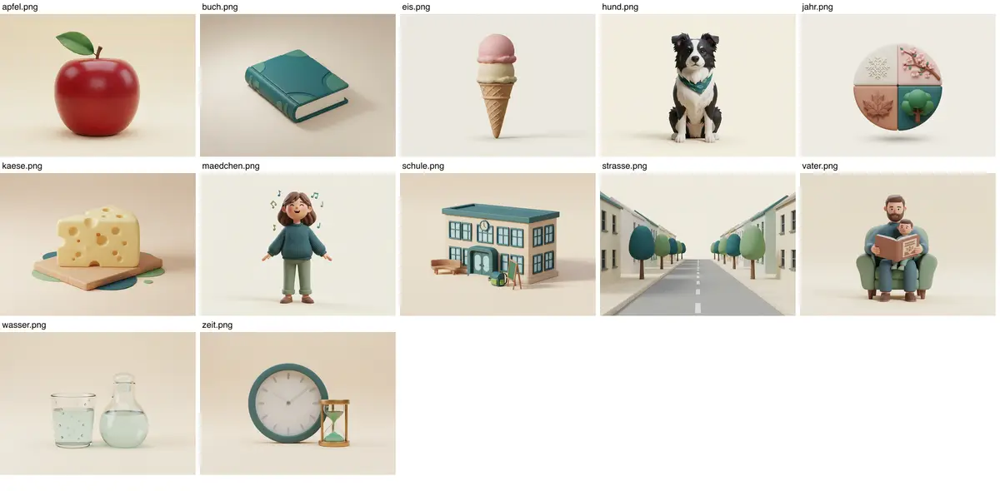
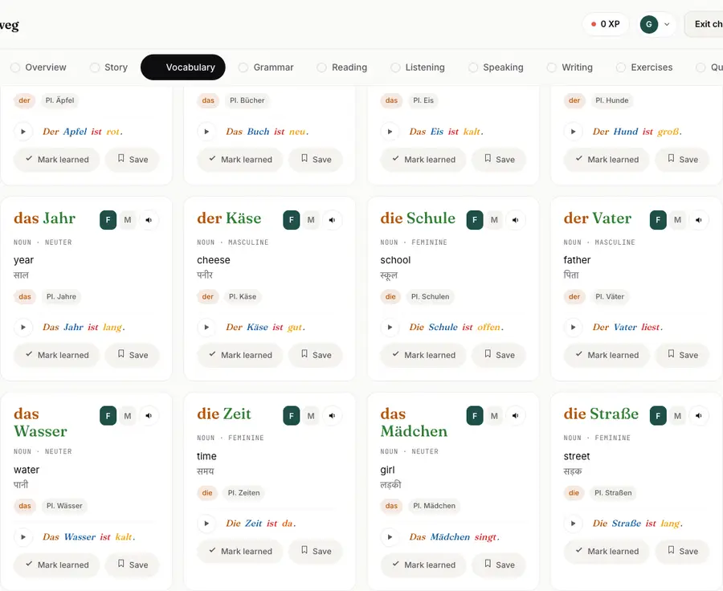
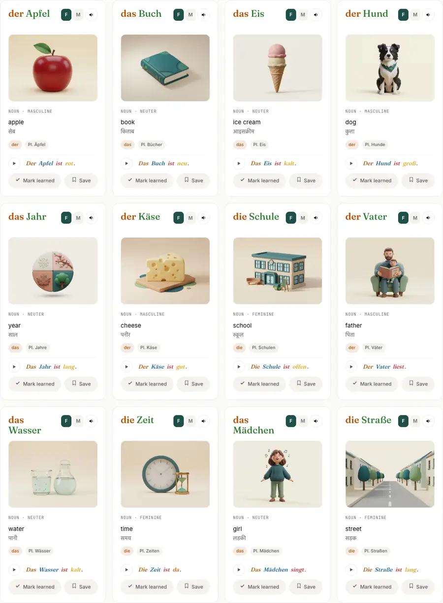
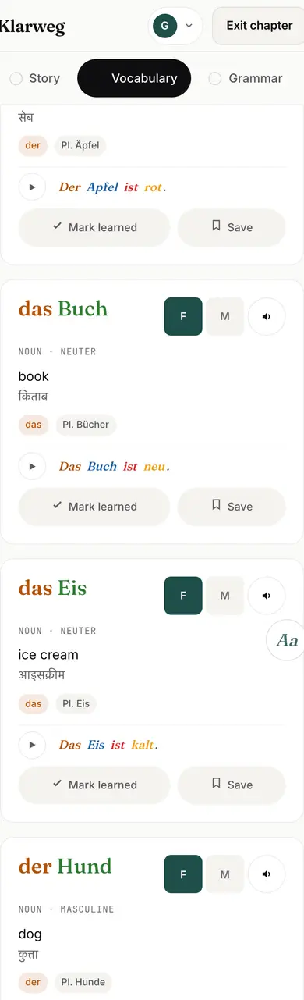
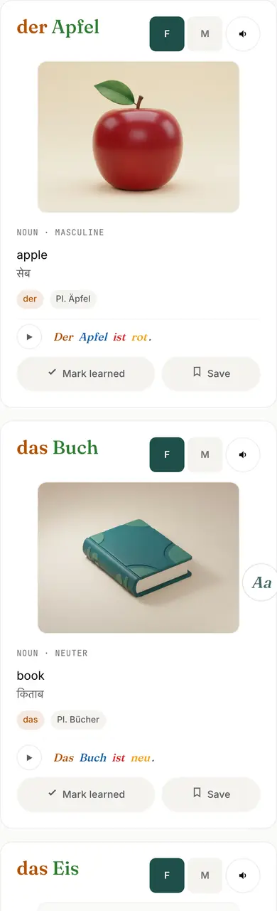

# Visual Vocabulary — A1·01 pilot

One illustration per vocabulary card, centered between the headword row and the
meaning. Pilot scope: **A1 · Chapter 1 (Das Alphabet), 12/12 words**. Not on any
other chapter. Not deployed.

## Data schema (optional; entries without `img` render exactly as before)

```js
{ de: 'Apfel', art: 'der', …,
  img: { src: '../public/vocab-img/a1-1/apfel',  // no extension; files are <src>-<width>.<format>
         formats: ['avif', 'webp'],              // <source> order; last one is the  fallback
         widths: [400, 800], w: 4, h: 3,         // srcset widths + intrinsic ratio
         alt: 'A shiny red apple with a green leaf' } }
```

Renderer: `vocabFigure()` in `chapter/chapter-app.js`. Lazy-loaded, async decode,
fixed 4:3 box (no layout shift), max 320 px wide. A missing file removes the
figure and the card falls back to text-only. `scripts/vocab-images.test.mjs`
checks that every declared file exists, is ≤ 60 KB, has alt text, and is listed in
`.github/pages-allowlist.txt`. `scripts/lexicon-split.mjs` ignores `img`, so
English alt text never enters the public German dictionary.

## Assets

`public/vocab-img/a1-1/` holds 12 words × {400, 800} × {AVIF, WebP} = 48 files,
233.7 KB total. A learner downloads only one size and one format: about **35 KB**
on a 1× desktop and about **62 KB** on a 2× phone (AVIF).

| Word | Depiction |
|---|---|
| der Apfel | red apple |
| das Buch | closed hardcover book |
| das Eis | ice cream cone (vanilla + strawberry) |
| der Hund | black-and-white dog |
| das Jahr | four-seasons wheel (abstract → contextual) |
| der Käse | cheese wedge on a board |
| die Schule | school building, clock, Schulranzen, chalkboard |
| der Vater | father reading to his child (matches „Der Vater liest.“) |
| das Wasser | glass + carafe of water |
| die Zeit | wall clock + hourglass (abstract → contextual) |
| das Mädchen | girl singing (matches „Das Mädchen singt.“) |
| die Straße | eye-level town street |



## How they were made (to extend to other chapters)

Original images from Google `gemini-2.5-flash-image` on Vertex AI (GCP project
`klarweg-512108`), 2026-11-11, owner-approved spend cap of $1.50. **20 images
generated for 12 used, ≈ $0.78** at $0.039/image. Imagen 4 is not offered to this
project. The rate limit is low, so generate sequentially. Cropped to 4:3 and
encoded with sharp (AVIF q52/56, WebP q74/78).

Shared style suffix (keep identical for consistency):

> Premium stylised 3D educational illustration in a refined matte clay-render style
> (soft rounded forms, subtle texture, not photographic) with gentle studio lighting
> and a soft contact shadow, single clear subject centered and filling about 70
> percent of the frame, plain very light warm cream seamless background (#F7F3EA),
> muted natural palette with deep teal and soft green accents, high detail, calm and
> minimal, no text, no letters, no numbers, no logos, no watermark, no orange tones.

Brand notes: no orange; no stock-photo people (`uploads/klarweg-os.md` §904), so
people are stylised clay figures; one subject per card; for nouns that are also in
the example sentence, the picture shows that sentence (Vater *liest*, Mädchen *singt*).

## Screenshots

| | Before | After |
|---|---|---|
| Desktop |  |  |
| Mobile 390 px |  |  |
